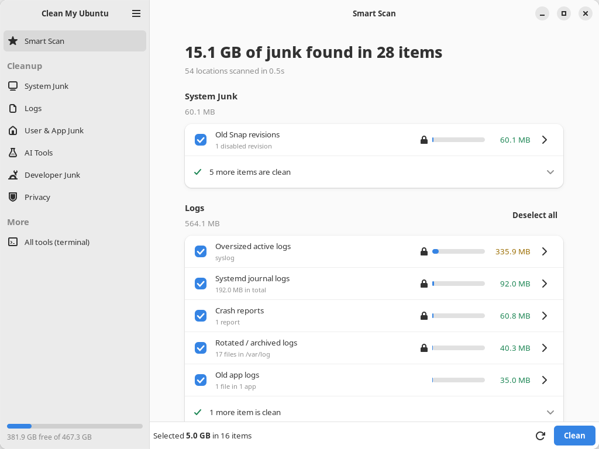
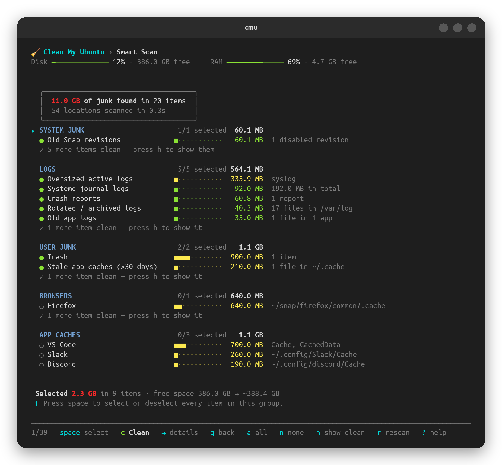

<p align="center">
  
</p>

<h1 align="center">Clean My Ubuntu</h1>

<p align="center">
  <a href="https://github.com/homielab/clean-my-ubuntu/actions/workflows/ci.yml"></a>
  
  <a href="https://launchpad.net/~homielab/+archive/ubuntu/clean-my-ubuntu"></a>
  
  
  <a href="https://ko-fi.com/homielab"></a>
</p>

**Free up disk space and keep Ubuntu tidy — safely.** Clean My Ubuntu finds caches, old logs,
leftovers of removed apps, developer and AI-tool clutter, and shows you exactly what it would
remove. Nothing is deleted until you confirm. It's a desktop app *and* a terminal app (`cmu`)
that share one engine.

[Install](#install) · [What it cleans](#what-it-cleans) · [Safety](#safe-by-design) · [FAQ](#faq) · [Report a bug](https://github.com/homielab/clean-my-ubuntu/issues)



## Why

I moved from macOS to Ubuntu and missed [CleanMyMac](https://macpaw.com/cleanmymac): one place
that tells you what's eating your disk and lets you clean it safely. Ubuntu has all the pieces —
`apt-get clean`, `journalctl --vacuum`, `snap remove --revision`, `docker image prune` — but you
have to know they exist and remember the flags. Clean My Ubuntu puts them behind one Scan button,
with a terminal version first, because that's where most Linux users live.

## Install

**Ubuntu 24.04 LTS** — from the [PPA](https://launchpad.net/~homielab/+archive/ubuntu/clean-my-ubuntu),
with updates through Software Updater:

```bash
sudo add-apt-repository ppa:homielab/clean-my-ubuntu
sudo apt install clean-my-ubuntu
```

Then open **Clean My Ubuntu** from *Show Apps*, or run `cmu` in a terminal.

**Any Ubuntu, without `sudo`** (including 22.04):

```bash
curl -fsSLO https://raw.githubusercontent.com/homielab/clean-my-ubuntu/main/clean-my-ubuntu.sh
bash clean-my-ubuntu.sh --install
```

That adds the app to *Show Apps* and the `cmu` command to your terminal, all inside your home
folder. On Ubuntu 22.04 the app grid opens the terminal app (the desktop app needs 24.04+).

**Other ways**

- **Package:** download `clean-my-ubuntu_<version>_all.deb` from
  [Releases](https://github.com/homielab/clean-my-ubuntu/releases), double-click it (App Center)
  or `sudo apt install ./clean-my-ubuntu_*_all.deb`.
- **Just try it:** `bash clean-my-ubuntu.sh --dry-run` — everything works, nothing is deleted.

## Use it

**Desktop app** — open *Clean My Ubuntu*, press **Scan**, untick anything you want to keep, press
**Clean**. Items with a 🔒 need your password (the standard Ubuntu dialog); everything else runs
as you.

**Terminal app** — run `cmu`. Press `1` for a Smart Scan, `c` to clean.



| Key | Action |
|---|---|
| `↑` `↓` / `j` `k` / mouse wheel | Move |
| `space` | Select or deselect (on a group header: the whole group) |
| `enter` / `→` | Open, or show exactly what's inside an item |
| `c` | Clean what's selected — you see the list and confirm first |
| `a` / `n` | Select all / none |
| `h` | Show or hide items that are already clean |
| `/` | Find a row by name |
| `z` | Undo: put back what you just moved to the Trash |
| `q` / `esc` / `←` | Back |
| `?` | Help |

Your choices are remembered by both apps: untick something once and it stays unticked.

## What it cleans

**Smart Scan** checks all of these at once (≈ 1 s):

| | What | Examples |
|---|---|---|
| **System Junk** | Package and system leftovers | APT cache, unused packages, extra old kernels (a fallback always stays), leftover configs, old Snap revisions, old temp files |
| **Logs** | Logs nobody reads | systemd journal (keeps 7 days), rotated logs, oversized live logs (e.g. a 300 MB `syslog`), crash reports, core dumps, old app logs |
| **User & App Junk** | Your caches | Trash, thumbnails, stale caches, and **each browser** and **each app** (VS Code, Slack, Discord, Steam's shader cache, Snap and Flatpak apps) as its own choice |
| **AI Tools** | AI assistant clutter | caches, logs and *old* sessions of Claude Code, Claude Desktop, Codex, Gemini/Antigravity, opencode, Zed, Copilot CLI, Continue |
| **AI Models** | Downloaded models | **each** Ollama, Hugging Face and LM Studio model on its own — never pre-selected, never cleaned automatically |
| **Developer Junk** | Build and package caches | npm, Yarn, pnpm, Bun, pip, Go, Cargo, Gradle, Maven, Conda; Docker images, build cache, containers and volumes (each separately); Podman; `node_modules` of projects idle for 90 days |

**Privacy** (never part of Smart Scan) clears shell history (bash, zsh, fish), *Recent files*,
Python/Node/database shell history, Vim history, and the Alt+F2 and emoji history.

**More tools in the terminal app:**

- **Uninstaller** — every app you can open (apt, Snap, Flatpak), with its real size (the app *plus*
  its folders in your home) and when you last used it. Sort by size or last use, or show only apps
  you haven't opened in 90+ days. Parts of Ubuntu itself are hidden, and a removal that would take
  something Ubuntu needs with it (GNOME Shell, the login screen, sudo, the running kernel…) is
  refused. Afterwards it offers the app's own folders for the Trash — never folders other apps share.
- **Maintenance** — update everything (with a list of what will change first), repair packages,
  TRIM, free RAM, and lasting limits so old snap versions and system logs don't pile up again.
- **System Overview** — storage, free-space history, and space outside your folders: Timeshift
  snapshots, the swap file, ext4's reserved space.
- Space Lens (browse folders by size), Large & Old Files (including virtual machine disks),
  Duplicates, Startup Items and Settings.

## Safe by design

- **You see everything first.** Every clean lists the items and sizes and asks; `→` shows the
  exact files. `--dry-run` shows the commands without running them.
- **It uses the system's own tools** — `apt-get clean`, `journalctl --vacuum-*`,
  `snap remove --revision`, `docker image prune`, `npm cache clean` — instead of deleting by hand.
- **Your files go to the Trash**, in the standard format, and `z` puts them back.
- **It never touches** logins and keys (`.ssh`, `.gnupg`, `auth.json`, `.credentials.json`, …),
  settings, bookmarks, Claude Code memory, the running kernel or its fallback.
- **Recent things stay:** only logs, sessions and caches older than a limit you control are
  removed; apps that are running are asked about (and skipped when unattended).
- **System paths are hard-blocked** (`/`, `/usr`, `/etc`, your home folder itself, …), and when it
  runs as root it refuses anything inside a home folder.
- **Everything is logged** to `~/.local/state/clean-my-ubuntu/clean.log` (*Settings → Activity log*).

## Automatic cleaning

*Settings → Automatic cleaning* runs a weekly (or daily, monthly) clean of user and developer
junk and notifies you: *"Freed 1.2 GB. Worth a look: Docker build cache 2.0 GB, Google Chrome
1.8 GB."* It never empties the Trash, never touches browsers or apps, never needs your password,
and can warn you when the disk is almost full.

## Command line

```bash
cmu --scan                        # what would Smart Scan find? (changes nothing)
cmu --clean                       # Smart Scan, confirm once, clean
cmu --clean --yes --only logs     # clean logs without asking
cmu --scan --only privacy         # what history is stored?
cmu --help                        # all options
```

## Update & uninstall

**Installed from the PPA or the `.deb`:** Software Updater (or `sudo apt upgrade`) keeps it up to
date; remove it with `sudo apt remove clean-my-ubuntu`.

**Installed with the script:**

```bash
cmu --update       # shows your version and the latest, asks, updates the app and icon
cmu --uninstall    # removes cmu, the desktop app and the Show Apps entry; asks about settings
```

The app also checks for a new version once a day (one request to GitHub; nothing about you is
sent) and shows **⬆ Update** in the menu — turn it off in *Settings → Daily update check*.

## FAQ

**Is it safe to clean the APT cache, journal and old snaps?**
Yes — that's what `apt-get clean`, `journalctl --vacuum-time` and `snap remove --revision` are for.
Packages are downloaded again if ever needed; the snap version you run is never removed.

**After cleaning, Ubuntu offered an upgrade to a new Ubuntu version. Did something break?**
No. Removing old Snap revisions makes systemd reload, which can bring Ubuntu's routine *"new
release available"* check forward. You can turn that prompt off in *Software & Updates → Updates*.

**Why is my `syslog` so big?**
Usually one service logs far too much. *Logs → Oversized active logs* empties it safely;
`sudo tail -n 1000 /var/log/syslog` shows who's flooding it.

**Does it work over SSH?** Yes — use the terminal app; colours and the mouse work in any modern terminal.

**Where does it keep its data?** `~/.config/clean-my-ubuntu` (choices, settings) and
`~/.local/state/clean-my-ubuntu` (activity log, last scan, stats). Nothing is sent anywhere —
see the [privacy policy](docs/PRIVACY.md).

## Contributing

Bug reports and pull requests are welcome — [CONTRIBUTING.md](CONTRIBUTING.md) explains how it
works, how to add a cleaner and how to run the tests. Plans are in
[docs/ROADMAP.md](docs/ROADMAP.md), releases in [CHANGELOG.md](CHANGELOG.md).

## Support

Clean My Ubuntu is free and always will be. If it saved you some space (or some time), you can
[buy me a coffee on Ko-fi](https://ko-fi.com/homielab) ☕ — it keeps the project going.

## License

[MIT](LICENSE) © 2026 [HomieLab](https://homielab.com) · contact@homielab.com

*Clean My Ubuntu is an independent open-source project, not affiliated with MacPaw or CleanMyMac.*
